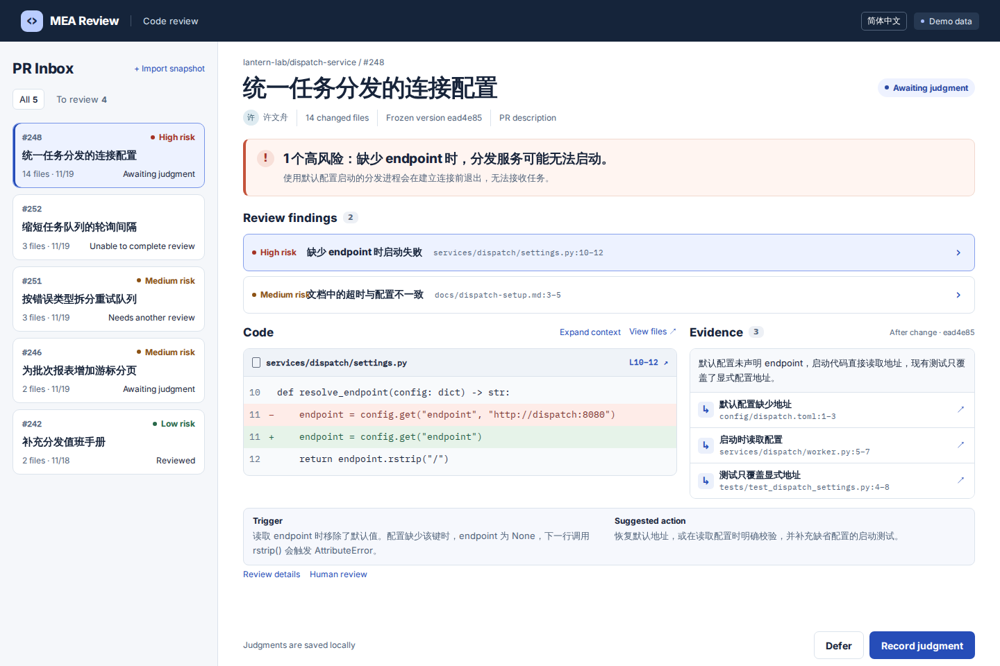

# MEA Review

MEA Review is a workbench for reviewing frozen pull requests by risk, checking findings against captured code and evidence, and recording human judgments.

[](docs/demo/showcase/risk-inbox.png)

[Watch the synthetic, offline walkthrough (MP4)](docs/demo/showcase/walkthrough.mp4?raw=true)

- **Triage by risk and status.** Open a frozen PR from the inbox and see where human review is needed or where a review stopped.
- **Inspect the code and evidence.** Open the cited lines, full diff, or supporting source with its path, side, revision, and line number.
- **Record a local judgment.** Accept, dismiss, or defer a finding in the workspace.
- **Recover from missing evidence.** See the recorded capture gaps and what to collect before reviewing again.

## Start the workbench

Run these commands with Git and Python 3.12 from a terminal:

```sh
git clone https://github.com/a27497/mea-review.git
cd mea-review
python3 -B -m mea serve --round3-demo --port 0 --task-dir "$(mktemp -d)"
```

Open the loopback URL printed after `MEA OFFLINE`. The demo opens to PR #248. Select **English** in the header for English controls. The authored PR titles and findings stay in Chinese. Press <kbd>Ctrl</kbd>+<kbd>C</kbd> in the terminal to stop the server.

## Known limitations

- This showcase is local-only. Application GitHub writeback is disabled. The walkthrough saves one judgment in a temporary workspace.
- The demo uses authored synthetic records. Real model execution is `NOT_RUN` and model quality for this showcase is `NOT_MEASURED`.
- Review is bounded by the frozen snapshot. Demo PR #252 shows **Unable to complete review** because the capture is incomplete. The next step is to capture the complete changed-file list and source for the same frozen version, then import the new snapshot.

## Desktop and mobile views

- **Desktop** · [Frozen diff at the selected line](docs/demo/showcase/frozen-diff.png) · [Stopped review and recapture guidance](docs/demo/showcase/review-stopped.png)
- **Mobile** · [Finding and risk summary](docs/demo/showcase/mobile-review.png) · [Frozen diff](docs/demo/showcase/mobile-diff.png)

The [capture script](docs/demo/showcase/record.mjs) starts a fresh loopback workspace, captures the built-in demo, and records the walkthrough.

## 中文简介

MEA Review 基于冻结的 PR 快照。先从收件箱查看风险和状态，再核对发现、差异和证据，最后记录本地人工判断。证据保留原始路径、行号、侧别与 revision。采集缺失、截断或锚点过期时，工作台会显示真实状态。演示只使用合成样本，不会向 GitHub 写回，也没有评测模型质量。

如需导入自己的快照，可选择 **导入快照**，在任务控制页加载获准使用的材料。旧版工作台提供确定性 Mock、模拟发布与只读对账。[产品阶段](docs/PRODUCT_STAGES.md) · [操作手册](docs/OPERATING_GUIDE.md)

## Other review workflows

- **Offline** supports frozen snapshot import, bounded static rules, citation inspection, and ReviewBench replay. Select **Import snapshot** to load a collected snapshot.
- **Deterministic Mock** supports investigation, per-comment confirmation, simulated writeback, and read-only reconciliation. Add `/workbench` to the printed loopback URL to open the classic workbench and its demo guide.
- **Re-review** compares explicitly captured frozen heads and shows renamed files, moved lines, and outdated anchors. If an incomplete increment leaves a file's lineage unknown, later use of the same name cannot establish continuity. Legacy workspaces with a sent or possibly sent anchor that crossed an increment without a `lineage_rule` block head-side drafting and preview from that increment onward. [Capture and re-review limits](docs/OPERATING_GUIDE.md)
- **Docker Compose** is an alternative local launch. Run `docker compose up --build`, open [the local workbench](http://127.0.0.1:8810), and select **Open local demo** on an empty workspace. Compose uses temporary container storage. Run `docker compose down` when finished. [Container settings](compose.yaml)

The historical ReviewBench v4 holdout experiment fell short of its preregistered improvement threshold. The frozen results document the real-model comparison separately from static rules, Mock, and offline replay. [Holdout results and methodology](benchmarks/reviewbench/v4/RESULTS.md#holdout-35-prs-42-deduplicated-gold-defects-3-repetitions) · [Auxiliary blind review](docs/REVIEWBENCH_AUXILIARY.md)

## Read-only MCP

The server exposes the workbench's bounded investigation tools and a snapshot inventory over stdio. Start with `snapshot_info`, then pass its base or head SHA to `read_diff`, `read_source`, `read_test`, `find_symbol`, `references`, `search` or `related_files`. Results include original path, side, revision and line. Search and import traversal cover collected files, and page limits and missing data are returned in the result. The server uses the Python standard library and the same bounded view as the agent. [MCP server implementation](mea/mcp_server.py)

Register it in Claude Code from the MEA checkout using absolute paths:

```sh
claude mcp add --env "PYTHONPATH=$PWD" --transport stdio mea-review -- \
  python3 -B -m mea.mcp_server --snapshot "$PWD/fixtures/review/v4.json"
```

For clients that launch outside the checkout, use the following stdio configuration. Replace both absolute checkout paths in the example.

```json
{
  "mcpServers": {
    "mea-review": {
      "command": "python3",
      "args": ["-B", "-m", "mea.mcp_server", "--snapshot", "/absolute/path/to/mea-review/fixtures/review/v4.json"],
      "env": { "PYTHONPATH": "/absolute/path/to/mea-review" }
    }
  }
}
```

Use only a snapshot the connected client is authorized to receive. MCP exposes frozen evidence to that client. The server has no model, confirmation or writeback tools. The [official SDK client check](scripts/mcp-roundtrip.mjs) connects, lists tools and makes calls against the synthetic fixture. [Claude Code setup reference](https://code.claude.com/docs/en/mcp)

## Optional real provider and GitHub CLI

These are separate, attended CLI workflows with explicit credentials and authorization.

- **Capture** reads a GitHub PR with a token that can access the repository. It pins the revision and records evidence gaps. Keep collected PR material in private storage. [Capture command and token sources](docs/OPERATING_GUIDE.md#capture-a-github-pull-request-read-only)
- **Investigate** with the DeepSeek CLI using an owner-readable key file, a scope binding the input digest, model and tool profile, and a bounded task, request and spend grant. The caller explicitly enables the billed run. [Real provider configuration](docs/OPERATING_GUIDE.md#run-the-controlled-real-deepseek-lane)
- **Publish** with a token that authorizes PR comments, an explicit repository allowlist and per-comment human approval of the exact text, head, file, line and side. The CLI checks the approval binding before recording the send intent. [Preview, confirm, send and reconcile](docs/OPERATING_GUIDE.md#send-confirmed-line-comments-attended-allowlisted)

## Verify

```sh
npm ci --ignore-scripts
npm test
node scripts/mcp-roundtrip.mjs
npm run test:e2e
npm run test:review-v3
npm run test:review-overview
python3 -I -B benchmarks/reviewbench/verify.py --out artifacts/reviewbench-offline-1
```

For browser verification, set `MEA_BROWSER` to a local Chromium or install the browser with `npx playwright install chromium`. For offline replay, use the versions in the [replay guide](benchmarks/reviewbench/README.md) and choose a fresh evidence directory. The replay uses Static, Direct Mock and Agent Mock. It also recomputes historical telemetry from frozen input. [Real benchmark aggregates](benchmarks/reviewbench/v4/RESULTS.md)

[Design tradeoffs](docs/DESIGN_TRADEOFFS.md) · [Operating guide](docs/OPERATING_GUIDE.md) · [Source manifest](SOURCE-MANIFEST.tsv) · [Third-party notices](THIRD_PARTY_NOTICES.md) · [MIT License](LICENSE)
