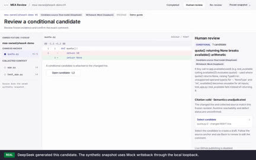
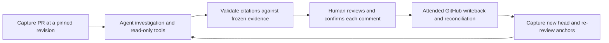

# MEA Review

MEA Review is a code review agent that investigates frozen pull requests using bounded, read-only tools and gives a human evidence-linked candidates to approve before GitHub writeback.

[Watch the workbench demo](docs/demo/mea-review.mp4?raw=true) · [Start locally](#start-the-workbench) · [Connect an MCP client](#read-only-mcp)

[](docs/demo/mea-review.mp4?raw=true)



### Frozen ReviewBench result

Mean precision, recall and F1 over [35 held-out pull requests and three repetitions](benchmarks/reviewbench/v4/RESULTS.md#holdout-35-prs-42-deduplicated-gold-defects-3-repetitions). The F1 column includes the range across repetitions.

| Arm | Precision | Recall | F1 (run range) |
| --- | ---: | ---: | ---: |
| Static · Offline | Undefined, no candidates | 0.000 | 0.000 |
| Direct · Real model | 0.137 | 0.151 | 0.143 (0.138–0.152) |
| Agent · Real model | 0.399 | 0.135 | **0.201** (0.172–0.246) |

The Agent gained **5.8 F1 points** over Direct (95% bootstrap CI **−2.4 to +12.8 points**). The gain fell short of the **10-point** preregistered threshold, so the experiment ended with a negative result. Agent recall was **13.5%**. The output is a set of candidates for human review. [Frozen metrics and confidence interval](benchmarks/reviewbench/v4/RESULTS.md#holdout-35-prs-42-deduplicated-gold-defects-3-repetitions)

In a small [auxiliary blind review](docs/REVIEWBENCH_AUXILIARY.md), independent reviewers confirmed issues beyond the gold list for **18 of 20 Agent** and **15 of 20 Direct** sampled candidates. The [33 defects missed by both arms](benchmarks/reviewbench/v4/RESULTS.md#mechanical-attribution-of-the-33-defects-neither-arm-found) had all of their commented lines visible in the first turn. That measurement covers anchor visibility. Availability of cross-file evidence was outside its scope.

## Start the workbench

From a clean clone with Docker and Compose installed:

```sh
docker compose up --build
```

Open [the local workbench](http://127.0.0.1:8810), then choose **Demo guide**. The default workbench uses synthetic frozen snapshots, deterministic investigations and simulated GitHub. It needs no credentials. [Container settings](compose.yaml)

- **Completed** opens an investigation. Expand the tool trace and select a citation to see its original side, revision and line.
- **Human review** opens a Mock candidate. Review its evidence, edit the draft, preview and confirm the exact comment, then choose **Send to Mock**. Use **Reconcile read-only** if an outcome is uncertain.
- **Re-review** compares frozen heads and shows renamed files, moved lines and outdated anchors.

Compose stores drafts and tasks in temporary container storage. Use `docker compose down` when finished. For local persistence, run [the Python workbench](mea/__main__.py) with `python3 -B -m mea serve --task-dir WORKSPACE_DIR`. Open **Import & task controls** to load a collected snapshot.

## What works today

| Stage | Capability |
| --- | --- |
| Implemented | **Offline** frozen snapshot import, bounded static rules, citation inspection and ReviewBench replay. **Mock** deterministic investigation, per-comment confirmation, writeback and reconciliation. **Real** read-only GitHub capture and attended, allowlisted GitHub writeback through the CLI. The read-only MCP server operates on a snapshot supplied at startup. |
| Experimental | **Real** DeepSeek investigation through the attended CLI, with budgeted tool calls and candidate validation. **Mock** provider protocol rehearsal with simulated requests and spending. |
| Planned | Automatic capture of a new head and a fresh review triggered by a PR update. The current workflow explicitly captures and compares a new frozen head. |

Capture may be incomplete. The workbench keeps missing, truncated and unavailable evidence visible. An increment can establish that an original comment anchor is outdated without moving the comment. If an incomplete increment leaves the file's lineage unknown, later use of the same name does not establish continuity. Legacy re-reviews with no lineage rule block head-side drafting for the saved version. [Capture and re-review limits](docs/OPERATING_GUIDE.md)

## Read-only MCP

The server exposes the workbench's [seven investigation tools and a snapshot inventory](mea/mcp_server.py) over stdio. Start with `snapshot_info`, then pass its base or head SHA to `read_diff`, `read_source`, `read_test`, `find_symbol`, `references`, `search` or `related_files`. Results include original path, side, revision and line. Search and import traversal cover collected files, and page limits and missing data are returned in the result. The server uses the Python standard library and the same bounded view as the agent.

Register it in Claude Code from the MEA checkout using absolute paths:

```sh
claude mcp add --env "PYTHONPATH=$PWD" --transport stdio mea-review -- \
  python3 -B -m mea.mcp_server --snapshot "$PWD/fixtures/review/v4.json"
```

For clients that launch outside the checkout, use the following stdio configuration. Replace both absolute checkout paths in the example.

```json
{
  "mcpServers": {
    "mea-review": {
      "command": "python3",
      "args": ["-B", "-m", "mea.mcp_server", "--snapshot", "/absolute/path/to/mea-review/fixtures/review/v4.json"],
      "env": { "PYTHONPATH": "/absolute/path/to/mea-review" }
    }
  }
}
```

Use only a snapshot the connected client is authorized to receive. MCP exposes frozen evidence to that client. The server has no model, confirmation or writeback tools. The [official SDK client check](scripts/mcp-roundtrip.mjs) connects, lists tools and makes calls against the synthetic fixture. [Claude Code setup reference](https://code.claude.com/docs/en/mcp)

## Real provider and GitHub CLI

- **Capture** reads a GitHub PR with a token that can access the repository. It pins the revision and records evidence gaps. Keep collected PR material in private storage. [Capture command and token sources](docs/OPERATING_GUIDE.md#capture-a-github-pull-request-read-only)
- **Investigate** with the DeepSeek CLI using an owner-readable key file, a scope binding the input digest, model and tool profile, and a bounded task, request and spend grant. The caller explicitly enables the billed run. [Real provider configuration](docs/OPERATING_GUIDE.md#run-the-controlled-real-deepseek-lane)
- **Publish** with a token that authorizes PR comments, an explicit repository allowlist and per-comment human approval of the exact text, head, file, line and side. The CLI checks the approval binding before recording the send intent. [Preview, confirm, send and reconcile](docs/OPERATING_GUIDE.md#send-confirmed-line-comments-attended-allowlisted)

## Verify

```sh
npm ci --ignore-scripts
npm test
node scripts/mcp-roundtrip.mjs
npm run test:e2e
npm run test:review-v3
python3 -I -B benchmarks/reviewbench/verify.py --out artifacts/reviewbench-offline-1
```

For browser verification, set `MEA_BROWSER` to a local Chromium or install the browser with `npx playwright install chromium`. For offline replay, use the versions in the [replay guide](benchmarks/reviewbench/README.md) and choose a fresh evidence directory. The replay uses Static, Direct Mock and Agent Mock. It also recomputes historical telemetry from frozen input. [Real benchmark aggregates](benchmarks/reviewbench/v4/RESULTS.md)

[Design tradeoffs](docs/DESIGN_TRADEOFFS.md) · [Operating guide](docs/OPERATING_GUIDE.md) · [Source manifest](SOURCE-MANIFEST.tsv) · [Third-party notices](THIRD_PARTY_NOTICES.md) · [MIT License](LICENSE)
